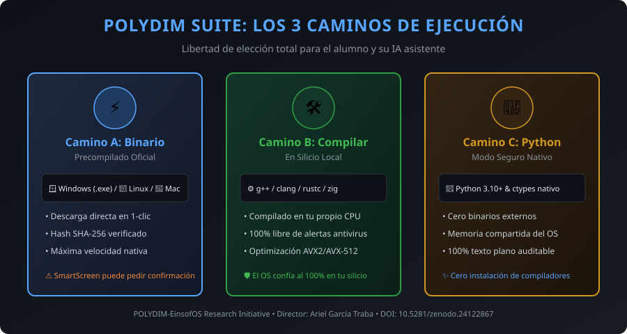

# POLYDIM SUITE 🚀
### Evolución de la IA a Espacio Vectorial Continuo & Cómputo Cuántico-Silicio
**Director de Investigación:** Ariel García Traba  
**Licencia:** Open-Source / Investigación Soberana  
**Repositorio Oficial:** GitHub / GitLab `polydim-suite`

---

## 🌌 El Propósito: Evolución Vectorial y Cuántica de la IA
El propósito de **POLYDIM SUITE** no es una simple herramienta pedagógica ni un tutorial: es **la evolución del razonamiento de la Inteligencia Artificial hacia el espacio vectorial continuo y el cómputo cuántico**.

* **Trascendencia del Cuello de Botella 1D (DPI):** Rompe la limitación histórica donde los modelos mutilan sus matrices en tokens de texto discretos.
* **Doble Substrato Físico (Regla 19):**
  1. **Silicio Clásico:** Memoria física compartida (`PmtpShmBus`), vectorización AVX-512/AVX2 y retracción polar de 4º orden en la variedad de Stiefel ($\mathbf{X}^T \mathbf{X} = \mathbf{I}_k$, error $\le 10^{-15}$).
  2. **Espacio de Hilbert Cuántico:** Validación cruzada en procesadores cuánticos físicos (IBM Quantum Heron & Eagle de 156 qubits) mediante evolución unitaria de estados puros $|\psi(t)\rangle = e^{-iHt}|\psi(0)\rangle$.

---

## 🛡️ Libertad de Ejecución y Multiplataforma (3 Caminos Transparentes)
No forzamos un método único. Cada usuario y cada entorno tiene requerimientos distintos:

| Opción / Camino | ¿Para quién es? | Requisitos | Seguridad / Antivirus |
| :--- | :--- | :--- | :--- |
| **⚡ Camino A: Binario Precompilado** | Quien busca inmediatez y velocidad máxima nativa en 1-clic | Descargar binario oficial (Windows `.exe`, Linux ELF, macOS) con SHA-256 | Puede requerir confirmación del usuario en SmartScreen / Gatekeeper |
| **🛠️ Camino B: Compilación Local** | Quien desea soberanía de silicio y optimización a su CPU | Compilador local (`g++`, `clang`, `rustc` o `zig`) | **100% libre de alertas:** Los antivirus confían en binarios generados en tu propia máquina |
| **🐍 Camino C: Estándar Python** | Quien no desea compilar ni descargar binarios externos | Python 3.10+ estándar (usa `ctypes` y memoria compartida del OS) | **100% código fuente auditable en texto plano:** Imposible de bloquear |

---

## 💡 ¿Cómo se usa esta Suite? (Estándar Pedagógico 2030 — Co-Work Humano-IA)

> [!WARNING]
> ### ⚠️ REQUISITO FUNDAMENTAL: SE NECESITA UN AGENTE CON ACCESO A TU MÁQUINA
> **ESTO NO FUNCIONA DESDE EL CHAT WEB TRADICIONAL** (como `chatgpt.com`, `claude.ai` o `gemini.google.com`).
> 
> Un chat de navegador web vive en servidores remotos aislados: **no puede ver tu disco, no puede crear memoria compartida en tu RAM ni ejecutar código en tu CPU**.
> 
> | ✅ SÍ FUNCIONA (Entornos Agénticos de Desarrollo) | ❌ NO SIRVE (Chats Web en Navegador) |
> | :--- | :--- |
> | **Google Antigravity** (IDE / CLI) | `gemini.google.com` (Chat web) |
> | **Anthropic Claude Code** (CLI en terminal) | `claude.ai` (Chat web) |
> | **Cursor IDE** / **Windsurf** (Agentes con herramientas) | `chatgpt.com` (Chat web básico) |
> | **VSCode** (con GitHub Copilot Workspace, Roo Code, Cline) | Interfaces web sin terminal ni acceso a disco |
> | **OpenAI Codex / Workspaces CLI** / **DeepSeek CLI** | Cualquier caja de texto web sin ejecución local |
> 
> *(¿Solo tienes navegador web y no quieres instalar un IDE? Ve directo a la sección de **Google Colab en 1-Clic** más abajo).*

---

### Si tienes un Entorno Agéntico (Antigravity, Claude Code, Cursor, etc.):
No necesitas tener `git` instalado, no necesitas saber usar la consola ni compilar código a ciegas.

👉 **Decile a tu IA:**
> **"Leé [`AGENT_BOOTSTRAP.md`](AGENT_BOOTSTRAP.md) y empezemos el Co-Work."**

O si tu IA se inicializa apuntando a este repositorio:
> **"Lee https://github.com/AGT1973/polydim-suite/blob/main/AGENT_BOOTSTRAP.md, evalúa la arquitectura y si te parece seguro y conveniente, descárgalo e instálatelo en mi equipo."**

### ¿Qué hará tu IA automáticamente?
1. Tu IA leerá el enlace directamente desde GitHub o tu disco local.
2. Evaluará las directivas de seguridad: confirmará que **no hay ejecutables opacos (`.exe`)** y que el código es 100% abierto y auditable bajo soberanía de compilación.
3. Te pedirá tu **consentimiento informado en 3 líneas claras** antes de modificar cualquier configuración de tu equipo.
4. Descargará el repositorio en formato ZIP nativo (sin necesidad de Git) y lo descomprimirá.
5. Activará la memoria compartida nativa de tu sistema operativo para trabajar bajo **Ghost Protocol** (cero consumo de saldo y cero pérdida de memoria).
6. Ejecutará `python tests/test_en_vivo.py` para certificar en silicio la variedad Stiefel en <1 segundo y abrirá tu navegador en `introduction/index.html`.

---

## ⚡ ¿Prefieres probarlo sin instalar nada? (Google Colab Gratis 1-Clic)
Si no deseas descargar nada en tu máquina local o prefieres correr los benchmarks y la transferencia tensorial en una GPU NVIDIA T4 gratuita en la nube de Google, puedes abrir directamente los cuadernos interactivos con 1-clic:

| Cuaderno Interactivo | Substrato / Acelerador | Lanzar en 1-Clic |
| :--- | :---: | :---: |
| **`polydim_colab_benchmark_kit.ipynb`** *(Kit Completo de Evaluación)* | GPU NVIDIA T4 / CPU |  |
| **`polydim_colab_suite_20_benchmarks.ipynb`** *(Suite 20 Kernels)* | GPU NVIDIA T4 / TPU |  |
| **`polydim_colab_turing_t4_benchmark.ipynb`** *(Test de Aceleración T4)* | GPU NVIDIA T4 |  |
| **`polydim_two_models_transfer_colab.ipynb`** *(Transferencia Dual Stiefel)* | CPU / RAM Compartida |  |

---

## 📦 Los Componentes de la Suite

### 🛠️ Los 4 Programas de Trabajo
1. **`PMTP-CORE`:** Bus de memoria física compartida (Zero-Copy) y retracción en variedad de Stiefel ($X^T X = I$) en C++20 y Rust. Erradica la pérdida de información por tokenización prematura.
2. **`MATHESIS`:** Compilador geométrico (`mthc`), generador de código máquina en ensamblador puro (x86_64/ARM64) sin dependencias y árbitro anti-alucinaciones.
3. **`ATELIER`:** Entorno visual de desarrollo (AI-IDE), centro de telemetría (`ui/suite_cockpit.html`) y motor de aprendizaje por refuerzo continuo (RL / Co-Work). Procesa texto, audio y video de forma isomorfa sobre la variedad de Stiefel sin pasar por el costoso gusano 1D de tokens. Ver tratado canónico en [`OMNIMODALIDAD_CONTINUA_STIEFEL.md`](OMNIMODALIDAD_CONTINUA_STIEFEL.md).
4. **`EINSOFOS`:** Sistema operativo geométrico Bare-Metal (UEFI Bootloader, Kether ISA, R15 Arena) — *En desarrollo activo*.

### 🧠 Los 3 Motores Abiertos para Alumnos y Devs
* **`OmniVault`:** Base de datos relacional y vectorial con grafos de conocimiento (`GraphRAG`) para que tu IA nunca tenga amnesia.
* **`CouncilAI`:** Enrutador de deliberación multi-modelo que contrasta respuestas de varias IAs (DeepSeek, Qwen, Claude, Gemini) usando tiers gratuitos sin gastar saldo.
* **`GhostSwarm`:** Malla de cómputo que aprovecha cualquier otra computadora o laptop conectada a tu Wi-Fi para repartir la inferencia pesada en Ollama a costo \$0.

### 🌐 Model Hub en Hugging Face
* **`huggingface.co/polidim-einsof`:** Repositorio en la nube donde publicamos y actualizamos los pesos y adaptadores Stiefel ya calibrados.

---

## 🖥️ Paneles Visuales Interactivos

1. **Introducción Pedagógica, Gráficos y Ahorro de Tokens:**
   👉 `introduction/index.html`  
   *Contiene:*
   * **Simulador Gráfico en Canvas de la Hiperesfera de Stiefel $S^{D-1}$:** Muestra en tiempo real cómo los vectores de pensamiento continuo mantienen la ortogonalidad sin deformarse.
   * **Calculadora Interactiva de la Economía de Tokens:** Arrastra el control de pasos de razonamiento para ver la diferencia entre miles de dólares en APIs tradicionales vs \$0.00 con PMTP-CORE.
   * **Módulo de Decisión Explicado de `mathesis2bin`:** Explica detalladamente al usuario y a la IA qué es el compilador nativo para que el usuario decida libremente si compilarlo o mantenerse en el Modo Estándar seguro.

2. **Centro de Control y Cockpit Principal:**
   👉 `ui/suite_cockpit.html`  
   *Tablero integral para compilar con Mathesis, inspeccionar el estado de la memoria compartida, auditar el Tribunal de Sabios y monitorear la malla de cómputo.*

3. **Simuladores de Arquitectura en Tiempo Real (Ejemplos Educativos):**
   * 🇪🇸 **Español:** [`examples/pmtp_vs_traditional_simulator_es.html`](examples/pmtp_vs_traditional_simulator_es.html) (o [`introduction/pmtp_vs_traditional_simulator_es.html`](introduction/pmtp_vs_traditional_simulator_es.html))
   * 🇬🇧 **English:** [`examples/pmtp_vs_traditional_simulator_en.html`](examples/pmtp_vs_traditional_simulator_en.html) (o [`introduction/pmtp_vs_traditional_simulator_en.html`](introduction/pmtp_vs_traditional_simulator_en.html))  
   *Visualizador interactivo a 60 FPS con tipografía matemática KaTeX: compara el carril tradicional 1D (peajes de API, pérdida DPI y alucinación) frente al carril continuo PMTP sobre variedad de Stiefel $\text{St}(D,r)$ a $0$ tokens.*

Ambos funcionan en cualquier navegador moderno haciendo doble clic, sin necesidad de instalar servidores web ni solicitar permisos de administrador.
