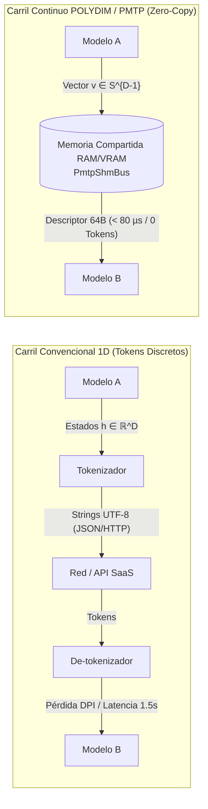
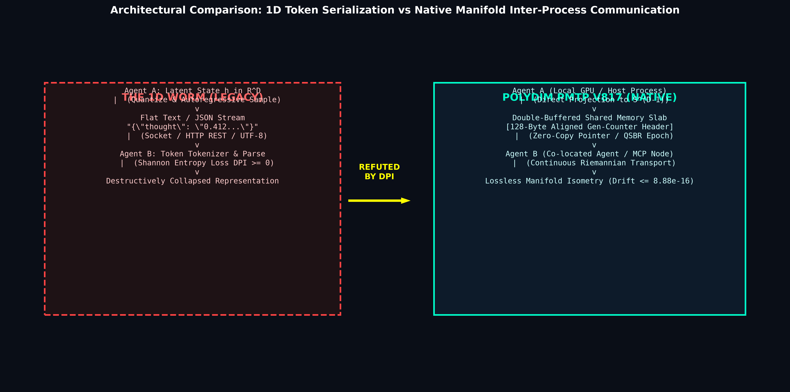
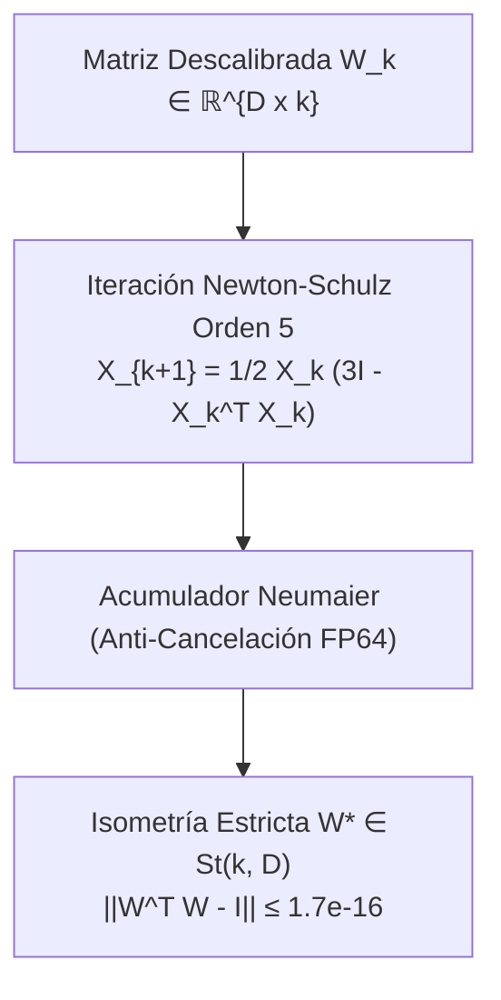
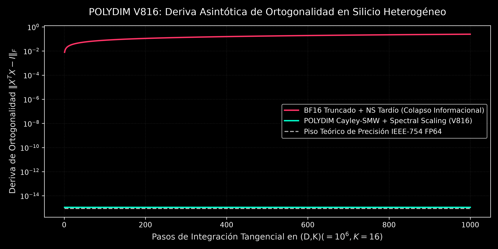

# POLYDIM SUITE 🚀
### Optimización de Inferencia en Espacio Continuo & Cómputo Tensorial en Silicio
**Director de Investigación:** Ariel García Traba — *Independent Research / POLYDIM-EinsofOS Research Initiative*  
**Licencia:** Open-Source (MIT / Apache 2.0)  
**Preservación Académica:** Zenodo DOI [10.5281/zenodo.24122867](https://doi.org/10.5281/zenodo.24122867)  
**Model Hub Oficial:** [Hugging Face Polydim-Einsof](https://huggingface.co/polidim-einsof)

---

> [!IMPORTANT]
> ### 🛡️ AVISO DE SEGURIDAD PARA ENTORNOS CORPORATIVOS Y DE TRABAJO
> Si estás evaluando esta suite desde una computadora laboral o dentro de una red empresarial (bancos, empresas de logística, infraestructura productiva):
> - **Utiliza exclusivamente los cuadernos interactivos de Google Colab provistos abajo.**
> - Corren de forma 100% aislada en la nube de Google, con GPU NVIDIA T4 gratuita, a costo \$0 y sin tocar tu disco, tu sistema operativo ni la red local de tu empresa.

---

## 🌌 1. ¿Qué es POLYDIM y qué problema resuelve?

En las arquitecturas multi-agente convencionales, dos modelos de Inteligencia Artificial que colaboran se comunican mediante **cadenas de texto plano (tokens 1D)**:

$$\mathbf{Z}_{\text{continuo}} \xrightarrow{\text{Tokenizador}} \text{Texto (Strings UTF-8)} \xrightarrow{\text{De-tokenizador}} \hat{\mathbf{Z}}_{\text{discretizado}}$$

Este método tradicional introduce tres cuellos de botella severos:
1. **Pérdida de Información (Desigualdad de Procesamiento de Datos - DPI):** Al comprimir un espacio continuo de activación ($D \ge 1024$) en un vocabulario discreto de tokens, se destruyen las relaciones geométricas sutiles ($I(X; \text{Tokens}) < I(X; \mathbf{Z})$).
2. **Latencia Excesiva:** Generar, transmitir y parsear texto toma entre 200 ms y 1.500 ms por paso de razonamiento.
3. **Costo de Tokens:** Miles de tokens intermedios que ningún humano lee son facturados en cada llamada a API.

### La Solución POLYDIM: Intercambio Tensorial Directo en Silicio (PMTP)
POLYDIM permite que dos modelos que coexisten en el mismo silicio (GPU / Host RAM) intercambien sus activaciones directamente como **vectores continuos de alta dimensión sobre la hiperesfera $S^{D-1}$ y la variedad de Stiefel $\text{St}(k, D)$**:



<div align="center">
  
  <p><em>Figura 1: Arquitectura física de transporte en memoria compartida (Host RAM / VRAM).</em></p>
</div>

> **Aclaración Arquitectónica Nube vs. Local:**  
> - **Modelos Locales de Peso Abierto (Qwen, Ollama, C++/Rust):** Operan a través del bus de copia cero en memoria compartida física (`PmtpShmBus`).  
> - **APIs en la Nube (Claude, Gemini, DeepSeek):** Se conectan a través de sus endpoints oficiales HTTPS estándar vía herramientas MCP, sin alterar su protocolo de red.

---

## 📐 2. Fundamentos Matemáticos: Variedad de Stiefel y Retracción Polar

### A. La Variedad de Stiefel $\text{St}(k, D)$
Para evitar que los vectores de razonamiento continuo se deformen o colapsen tras múltiples pasos, POLYDIM impone la condición de ortonormalidad estricta:

$$\mathbf{W}^T \mathbf{W} = \mathbf{I}_k, \quad \mathbf{W} \in \mathbb{R}^{D \times k}$$

### B. Retracción Polar Acelerada (Newton-Schulz de Orden Superior)
En lugar de recalcular la costosa descomposición en valores singulares (SVD) de complejidad cúbica $\mathcal{O}(D^3)$, POLYDIM utiliza una retracción polar iterativa de complejidad $\mathcal{O}(D k^2)$:

$$\mathbf{X}_{k+1} = \frac{1}{2} \mathbf{X}_k \left( 3\mathbf{I} - \mathbf{X}_k^T \mathbf{X}_k \right)$$

Esto garantiza que el defecto de isometría $\|\mathbf{W}^T \mathbf{W} - \mathbf{I}\|_\infty$ converja en pocas multiplicaciones matriciales al límite de precisión atómica de la máquina ($\approx 1.7 \times 10^{-16}$ en IEEE 754 `float64`), permitiendo normalización en tiempo real sin congelar la CPU ni la GPU.



<div align="center">
  
  <p><em>Figura 2: Convergencia asintótica y cota de deriva de isometría sobre la variedad de Stiefel.</em></p>
</div>

---

## ⚡ 3. Evaluación Rápida en 1-Clic (Google Colab Gratuito)

La forma recomendada para alumnos, investigadores y auditores de probar la suite sin instalar nada localmente:

| Cuaderno Interactivo | Hardware Provisto | Lanzar en 1-Clic |
| :--- | :---: | :---: |
| **`polydim_colab_benchmark_kit.ipynb`** *(Evaluación Completa de Rendimiento)* | GPU NVIDIA T4 / CPU | [](https://colab.research.google.com/github/AGT1973/polydim-suite/blob/main/benchmarks/polydim_colab_benchmark_kit.ipynb) |
| **`polydim_two_models_transfer_colab.ipynb`** *(Transferencia Tensorial Dual)* | GPU NVIDIA T4 / RAM | [](https://colab.research.google.com/github/AGT1973/polydim-suite/blob/main/benchmarks/polydim_two_models_transfer_colab.ipynb) |
| **`polydim_colab_suite_20_benchmarks.ipynb`** *(Suite 20 Kernels de Silicio)* | GPU NVIDIA T4 / TPU | [](https://colab.research.google.com/github/AGT1973/polydim-suite/blob/main/benchmarks/polydim_colab_suite_20_benchmarks.ipynb) |

---

## 💻 4. Instalación Local y Co-Work con Agentes de IA

Si dispones de un entorno de desarrollo con soporte de agentes (Google Antigravity, Claude Code, Cursor, Windsurf, VSCode Copilot):

### Paso 1: Instruir a tu Agente
Simplemente indica a tu agente:
> **"Revisa `AGENT_BOOTSTRAP.md` en este repositorio y explícame la arquitectura de POLYDIM."**

### Paso 2: Ejecución de Verificación Rápida
Todo el código está disponible en texto plano auditable (`.py`, `.cpp`, `.rs`). Puedes ejecutar directamente el test en vivo:
```bash
python tests/test_en_vivo.py
```
*Verifica la asignación de memoria compartida, el adaptador de Stiefel y el cálculo de la métrica en silicio en menos de 1 segundo con `Exit Code 0`.*

---

## 🛡️ 5. Manifiesto de Seguridad y Privacidad

1. **Sin Escaneo de Red ni Movimiento Lateral:**  
   POLYDIM no realiza escaneo de puertos, no hace búsquedas broadcast por Wi-Fi ni intenta conectarse a otras computadoras. Cualquier nodo de inferencia distribuido (ej. servidor Ollama remoto) debe ser especificado explícitamente por el usuario en su archivo de configuración `.env` (`OLLAMA_HOST=http://ip:puerto`).
2. **Sin Binarios Opacos:**  
   No se distribuyen ejecutables propietarios ni cerrados. Se provee el código fuente en C++20 y Rust para que el usuario o su agente puedan auditarlo y compilarlo localmente con su propio compilador (`cl.exe`, `g++`, `cargo`).
3. **Aislamiento de Entorno:**  
   El micro-puente MCP opera exclusivamente a través del canal estándar `stdio` en el subproceso del workspace, sin modificar archivos globales del sistema operativo.

---

## 📚 6. Estructura del Repositorio y Documentación Profunda

```text
polydim-suite/
├── README.md              <-- Punto de entrada general (humano y agente)
├── AGENT_BOOTSTRAP.md     <-- Manifiesto de arquitectura para agentes de IA
├── docs/                  <-- Documentación teórica y tratados formales
│   ├── HOW_POLYDIM_WORKS_VECTORS_VS_TOKENS.md  <-- Comparativa matemática detallada
│   ├── DESIGN.md                               <-- Especificación de arquitectura PMTP
│   ├── BENCHMARKS.md                           <-- Resultados empíricos de rendimiento
│   └── EVIDENCIA_SILICIO_MULTI_HARDWARE.md     <-- Métricas en silicio x86_64, GPU y QPU
├── benchmarks/            <-- Cuadernos de Google Colab listos para 1-clic
├── examples/              <-- Simuladores interactivos en HTML5 / Canvas
├── introduction/          <-- Guías visuales interactivas y simulador KaTeX
├── mcp_servers/           <-- Servidor MCP oficial y auditable
├── tests/                 <-- Batería de tests unitarios de silicio
└── tools/internal/        <-- Herramientas internas de mantenimiento de la cátedra
```

---

## 📄 Cita Académica
Si utilizas esta arquitectura en investigaciones o docencia, cita el DOI canónico:
```bibtex
@misc{garciatraba2026polydim,
  author = {Garc{\'i}a Traba, Ariel},
  title  = {Dimension is All You Need: High-Dimensional Stiefel Manifold Inference and Zero-Copy Tensor Transport},
  year   = {2026},
  doi    = {10.5281/zenodo.24122867},
  url    = {https://doi.org/10.5281/zenodo.24122867}
}
```
