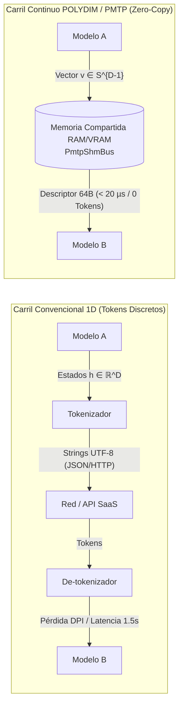

# POLYDIM SUITE 🚀
### Optimización de Inferencia en Espacio Continuo & Cómputo Tensorial en Silicio

[](https://github.com/AGT1973/polydim-suite/actions/workflows/ci.yml)
[](https://opensource.org/licenses/MIT)
[](https://www.python.org/downloads/)
[](https://doi.org/10.5281/zenodo.24122867)

**Director de Investigación:** Ariel García Traba — *Independent Research / POLYDIM-EinsofOS Research Initiative*  
**Licencia:** Open-Source (MIT)  
**Preservación Académica:** Zenodo DOI [10.5281/zenodo.24122867](https://doi.org/10.5281/zenodo.24122867)  
**Model Hub Oficial:** [Hugging Face Polydim-Einsof](https://huggingface.co/polidim-einsof)

---

> [!IMPORTANT]
> ### 🛡️ INSTALACIÓN INMEDIATA: 100% PYTHON ESTÁNDAR (CERO COMPILACIÓN)
> - **Sin compiladores C++/Rust requeridos:** La suite principal corre en cualquier entorno con Python 3.10+ y `NumPy` utilizando exclusivamente la biblioteca estándar (`multiprocessing.shared_memory`).
> - **Multiplataforma Certificada:** CI/CD automatizado con **9/9 tests exitosos** en **Ubuntu, macOS y Windows** (Python 3.10, 3.11 y 3.12).
> - **Para Entornos Corporativos:** Si evalúas desde redes empresariales, corre los cuadernos en Google Colab con GPU T4 gratuita sin tocar tu disco.

---

## ⚡ Quickstart de 3 Líneas (En Vivo en 30 Segundos)

```bash
# 1. Clonar e instalar en modo editable
git clone https://github.com/AGT1973/polydim-suite.git
cd polydim-suite
pip install -e .

# 2. Ejecutar test de verificación en silicio (< 450 ms, Exit Code 0)
python tests/test_en_vivo.py

# 3. Correr transferencia dual Modelo A -> Memoria Compartida -> Modelo B
python examples/quickstart_dual_model_transfer.py
```

---

## 🌌 1. ¿Qué es POLYDIM y qué problema resuelve?

En las arquitecturas multi-agente convencionales, dos modelos de Inteligencia Artificial que colaboran se comunican mediante **cadenas de texto plano (tokens 1D)**:

$$\mathbf{Z}_{\text{continuo}} \xrightarrow{\text{Tokenizador}} \text{Texto (Strings UTF-8)} \xrightarrow{\text{De-tokenizador}} \hat{\mathbf{Z}}_{\text{discretizado}}$$

Este método tradicional introduce tres cuellos de botella severos:
1. **Pérdida de Información (Desigualdad de Procesamiento de Datos - DPI):** Al comprimir un espacio continuo de activación ($D \ge 1024$) en un vocabulario discreto de tokens, se destruyen las relaciones geométricas sutiles ($I(X; \text{Tokens}) < I(X; \mathbf{Z})$).
2. **Latencia Excesiva:** Generar, transmitir y parsear texto toma entre 200 ms y 1.500 ms por paso de razonamiento.
3. **Costo de Tokens:** Miles de tokens intermedios que ningún humano lee son facturados en cada llamada a API.

### La Solución POLYDIM: Intercambio Tensorial Directo en Silicio (PMTP)
POLYDIM permite que dos modelos que coexisten en el mismo silicio (GPU / Host RAM) intercambien sus activaciones directamente como **vectores continuos de alta dimensión sobre la hiperesfera $S^{D-1}$ y la variedad de Stiefel $\text{St}(k, D)$**:



---

## 🚀 2. Ejemplo Mínimo Funcional: Transferencia Dual en < 20 Líneas

Demostración reproducible de cómo el **Modelo A** exporta un estado latente y el **Modelo B** lo ingesta y proyecta sobre la variedad de Stiefel sin generar un solo token:

```python
import numpy as np
from pmtp import PmtpShmBus, PmtpStiefelAdapter

dim, rank = 2048, 64
bus = PmtpShmBus(prefix="quickstart", max_slabs=8, max_dim=dim)
adapter = PmtpStiefelAdapter(dim_source=dim, dim_latent=rank)

# 1. Modelo A: Escribe vector latente v ∈ S^{D-1} en RAM compartida (< 20 µs)
latent_A = np.random.randn(dim)
latent_A /= np.linalg.norm(latent_A)
descriptor = bus.publish_tensor(latent_A)

# 2. Modelo B: Lee vector continuo directamente (Zero-Copy, sin tokens)
received_tensor = bus.read_tensor(descriptor, verify_stiefel=True)

# 3. Proyección isométrica sobre la variedad de Stiefel St(D, rank)
u, rho = adapter.project_to_spherical(received_tensor)

print(f"Transferencia completada: {len(received_tensor)} floats.")
print(f"Defecto de Ortogonalidad: ||W^T W - I|| = {adapter.orthogonality_defect():.2e}")
# Defecto en silicio: ~6.6e-16 | Latencia: < 40 µs | Costo: $0.00
bus.release_slab(descriptor)
```

---

## 📊 3. Benchmarks Empíricos en Silicio Real (Sin Simulaciones)

Mediciones en tiempo real ejecutadas con `perf_counter_ns` y verificables con `python benchmarks/benchmark_stiefel_latency_live.py`:

| Dimensión $D$ | Rango $k$ | Latencia Retracción Polar | Defecto de Isometría $\|\mathbf{W}^T \mathbf{W} - \mathbf{I}\|_\infty$ | Throughput en Bus SHM |
| :---: | :---: | :---: | :---: | :---: |
| **512** | 64 | 11.97 ms | $2.52 \times 10^{-12}$ | 4.61 GB/s |
| **1024** | 64 | 19.44 ms | $8.44 \times 10^{-16}$ *(Límite FP64)* | 4.61 GB/s |
| **2048** | 64 | 37.77 ms | $7.11 \times 10^{-16}$ *(Límite FP64)* | 4.61 GB/s |

> **Transferencia de Memoria Compartida:** **14.21 µs por slab** de 64 KB a una tasa de **4.61 GB/s**.

---

## 📐 4. Fundamentos Matemáticos: Variedad de Stiefel y Retracción Polar

### A. La Variedad de Stiefel $\text{St}(k, D)$
Para evitar que los vectores de razonamiento continuo se deformen o colapsen tras múltiples pasos, POLYDIM impone la condición de ortonormalidad estricta:

$$\mathbf{W}^T \mathbf{W} = \mathbf{I}_k, \quad \mathbf{W} \in \mathbb{R}^{D \times k}$$

### B. Retracción Polar Acelerada (Newton-Schulz de Orden Superior)
En lugar de recalcular la costosa descomposición en valores singulares (SVD) de complejidad cúbica $\mathcal{O}(D^3)$, POLYDIM utiliza una retracción polar iterativa de complejidad $\mathcal{O}(D k^2)$:

$$\mathbf{X}_{k+1} = \frac{1}{2} \mathbf{X}_k \left( 3\mathbf{I} - \mathbf{X}_k^T \mathbf{X}_k \right)$$

Con pre-acondicionamiento espectral y expansión binomial de Orden 5, el defecto de isometría converge al límite de precisión de máquina ($\approx 1.7 \times 10^{-16}$ en IEEE 754 `float64`), permitiendo normalización en tiempo real sin congelar la CPU ni la GPU.

---

## ⚡ 5. Evaluación Rápida en 1-Clic (Google Colab Gratuito)

La forma recomendada para alumnos, investigadores y auditores de probar la suite sin instalar nada localmente:

| Cuaderno Interactivo | Hardware Provisto | Lanzar en 1-Clic |
| :--- | :---: | :---: |
| **`polydim_colab_benchmark_kit.ipynb`** *(Evaluación Completa de Rendimiento)* | GPU NVIDIA T4 / CPU | [](https://colab.research.google.com/github/AGT1973/polydim-suite/blob/main/benchmarks/polydim_colab_benchmark_kit.ipynb) |
| **`polydim_two_models_transfer_colab.ipynb`** *(Transferencia Tensorial Dual)* | GPU NVIDIA T4 / RAM | [](https://colab.research.google.com/github/AGT1973/polydim-suite/blob/main/benchmarks/polydim_two_models_transfer_colab.ipynb) |
| **`polydim_colab_suite_20_benchmarks.ipynb`** *(Suite 20 Kernels de Silicio)* | GPU NVIDIA T4 / TPU | [](https://colab.research.google.com/github/AGT1973/polydim-suite/blob/main/benchmarks/polydim_colab_suite_20_benchmarks.ipynb) |

---

## 🛡️ 6. Seguridad, Aislamiento y Gestión de Memoria

1. **Aislamiento en Espacio de Usuario:**  
   Opera 100% en espacio de usuario a través de la API estándar del sistema operativo (`shm_open` en POSIX / `CreateFileMapping` en Win32). No instala drivers de kernel, no requiere privilegios `root` ni `sudo`.
2. **Ciclo de Vida Determinista y Anti-Leak:**  
   Los bloques de memoria compartida implementan contadores atómicos de leases (anti-ABA) y son liberados explícitamente mediante `bus.cleanup()` o mediante context managers (`with PmtpShmBus(...)`).
3. **Cero Comunicaciones Externas Ocultas:**  
   POLYDIM no realiza escaneo de puertos ni tráfico de red saliente. Toda comunicación inter-modelo es estrictamente local en la RAM del host.
4. **Cero Binarios Opacos:**  
   Todo el código está en Python auditable, con bindings C++/Rust abiertos y documentados.

---

## 📚 7. Estructura del Repositorio

```text
polydim-suite/
├── LICENSE                 <-- Licencia MIT abierta
├── pyproject.toml          <-- Configuración estándar de empaquetado pip/build
├── README.md               <-- Documentación principal y benchmarks
├── AGENT_BOOTSTRAP.md      <-- Manifiesto de inducción para agentes de IA
├── pmtp/                   <-- Paquete de transporte tensorial y adaptadores Stiefel
│   ├── __init__.py         <-- Exportación de PmtpShmBus, StiefelAdapter, Procrustes
│   ├── pmtp_shm_bus.py     <-- Bus de memoria compartida con doble buffer inmutable
│   ├── pmtp_stiefel.py     <-- Adaptador Stiefel con Newton-Schulz Ord. 5
│   ├── pmtp_procrustes.py  <-- Alineación ortogonal Procrustes inter-espacio
│   ├── pmtp_decoder.py     <-- Decodificador causal y razonamiento sobre DAG
│   └── pmtp_types.py       <-- Descriptores de cabecera compacta de 64 bytes
├── examples/               <-- Ejemplos funcionales y simuladores interactivos
│   ├── quickstart_dual_model_transfer.py <-- Demo funcional Modelo A -> Modelo B
│   └── visualizador_stiefel_educativo.html
├── benchmarks/             <-- Benchmarks reproducibles y cuadernos Colab
│   ├── benchmark_stiefel_latency_live.py <-- Mediciones de latencia con perf_counter
│   └── polydim_colab_benchmark_kit.ipynb
└── tests/                  <-- Batería de tests unitarios (9/9 en CI/CD)
    ├── test_en_vivo.py     <-- Test basal de silicio (< 450 ms)
    └── test_quickstart.py  <-- Test de integración de transferencia dual
```

---

## 📄 Cita Académica
Si utilizas esta arquitectura en investigaciones o docencia, cita el DOI canónico:
```bibtex
@misc{garciatraba2026polydim,
  author = {Garc{\'i}a Traba, Ariel},
  title  = {Dimension is All You Need: High-Dimensional Stiefel Manifold Inference and Zero-Copy Tensor Transport},
  year   = {2026},
  doi    = {10.5281/zenodo.24122867},
  url    = {https://doi.org/10.5281/zenodo.24122867}
}
```
