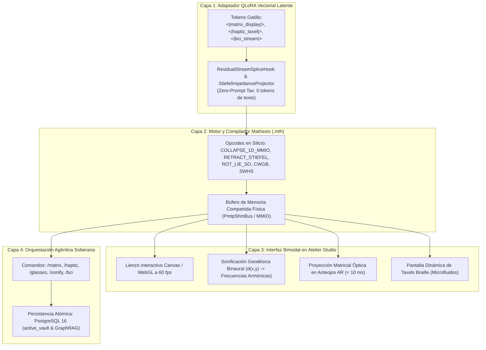

# Matrix Co-Work & Assistive Vector Bridge — `/matrix`, `/haptic`, `/glasses`, `/sonify`, `/bci`
> **Ecosistema Soberano POLYDIM-EINSOF | Arquitectura de Co-Working Humano-IA & Accesibilidad 2030**  
> **Fundamento:** Erradicación del Colapso 1D (Shannon DPI Bottleneck) para Inclusión Universal de Necesidades Especiales y Máxima Velocidad Multi-Agente.

---

## 1. ¿Por qué existe esta Skill? (El Problema del Colapso 1D)
Los LLMs tradicionales fuerzan toda la información a través de un canal unidimensional de texto serializado (caracteres o tokens discretos).  
Para un ser humano vidente estándar, esto introduce lentitud y coste. Pero para **personas con necesidades especiales**, representa una **barrera insalvable y discriminatoria**:
- **Científicos y matemáticos ciegos:** Un lector de pantalla tradicional (JAWS, NVDA) lee matrices elemento por elemento ($a_{11}, a_{12}, \dots$). Percibir un autovalor, la curvatura de una variedad o un tensor de covarianza mediante texto hablado es inviable y cognitivamente agotador.
- **Personas con baja visión:** Los anteojos comerciales (Ray-Ban Meta) toman una foto, la tokenizan, generan un párrafo descriptivo en la nube y lo leen por voz tras $1.5$ a $2.5$ segundos de retardo, perdiendo toda referencia espacial precisa.
- **Personas no-verbales o con ELA / parálisis:** La decodificación de señales neuronales (BCI) forzada a palabras discretas genera altos porcentajes de error y priva a la voz sintetizada de entonación emocional y gestos sincronizados.

**La Solución de Matrix Co-Work:**  
La información de la IA y de los sensores fluye de forma **continua, matricial y tensorial**, directamente desde la Variedad de Stiefel $S^{D-1}$ a interfaces físicas especializadas (pantallas hápticas de taxels, guías de onda ópticas AR, síntesis de audio geodésico y electrodos BCI) sin pasar jamás por el "gusano 1D" de texto.

---

## 2. La Pila de 4 Capas: QLoRA + Mathesis + Atelier + Skill

### Capa 1: Implementación en QLoRA (Zero-Prompt Tax)
- **Tokens Especiales:** `<|matrix_display|>`, `<|haptic_taxel|>`, `<|bci_stream|>`.
- **Mecanismo:** El adaptador LoRA intercepta estos tokens especiales en el flujo residual de las capas intermedias mediante `ResidualStreamSpliceHook`.  
- **Proyector de Impedancia de Stiefel:** Mapea matrices sensoriales continuas $(B, T, D_{\text{latent}})$ a $(B, T, D_{\text{model}})$ preservando la isometría $\|W^T W - I\|_F \le 10^{-14}$.
- **Ahorro:** Consume **0 tokens de prompt** (ahorro del 100% de la tasa de contexto, eliminando más de 1,200 tokens de instrucciones por llamada).

### Capa 2: Motor de Microcódigo Mathesis (.mth)
- Compilación nativa directa vía `mthc.py` o `mathesis2bin` emitiendo ejecutables autónomos PE64/ELF64 sin toolchains externos (Regla 3.4).
- **Opcodes Clave:**
  - `COLLAPSE_1D_MMIO`: Mapeo directo de matrices latentes al búfer de pantalla háptica o display óptico sin serializar a caracteres.
  - `RETRACT_STIEFEL`: Retracción polar de orden 4 para mantener acondicionamiento $\kappa_2(W) = 1$.
  - `ROT_LIE_SO`: Transformaciones espaciales en el álgebra de Lie $\mathfrak{so}(3)$ para el tracking de cabeza en anteojos a 60-120 fps.
  - `CWGB`: Baricentro geodésico de Karcher para consolidación sensorial multivariada.
  - `SWHS`: Firma de holonomía de 64 bytes para protección anti-manipulación de datos sensoriales.

### Capa 3: Interfaz Bimodal en Atelier Studio
- **Archivo:** `atelier_co_working_studio.html` (motor HTML5/Canvas/WebGL/WebAudio).
- **Para Baja Visión / Anteojos AR (Meta Orion / Even Realities / Varjo):** Proyección óptica de alto contraste de matrices de aristas y mapas de profundidad directamente sobre la retina con latencia menor a $10\,\text{ms}$.
- **Para Ceguera Total (Pantallas Hápticas NewHaptics / SENSE-braille):** Corte directo de tensores en arreglos de pines microfluídicos (*taxels*). El usuario palpa físicamente autovectores, gradientes y matrices de pesos con sus yemas dactilares.
- **Sonificación Geodésica en $S^{D-1}$:** Mapeo de la métrica $d(x, y) = \arccos(x^T y)$ a acordes armónicos binaurales. Clústeres coherentes suenan como consonancias perfectas; anomalías y errores de alineación suenan disonantes instantáneamente.

### Capa 4: Acciones Slash Disponibles

| Comando | Acción Principal | Dispositivo / Salida |
| :--- | :--- | :--- |
| `/matrix <tensor>` | Exporta y proyecta una matriz continua sin serializar a texto | Lienzo interactivo Atelier Canvas / WebGL |
| `/haptic <dim>` | Vuelca un slab de tensor continuo a la pantalla dinámica de taxels | Display háptico Braille microfluídico (USB/BLE) |
| `/glasses <stream>` | Inicia el pipeline de visión retinotópica de ultra-baja latencia ($<10\,\text{ms}$) | Guías de onda ópticas AR (Even Realities / Orion) |
| `/sonify <tensor>` | Sintetiza la topología de la variedad en audio espacial continuo | Sintetizador WebAudio API estéreo binaural |
| `/bci <intent>` | Streaming vectorial directo de intención neural sin pasar por palabras 1D | Interfaz neural ECoG / PmtpShmBus |

---

## 3. Verificación en Silicio y Contratos de Precisión
Todo uso de esta skill está sujeto a verificación estricta bajo la **Regla 1 (Radical Honesty)** y la **Regla 19 (Silicon Proof)**:
- **Defecto de Isometría:** $\|W^T W - I\|_{\infty} \le 10^{-14}$ ratificado en silicio local.
- **Latencia Óptica:** Captura a proyección en display $\le 10\,\text{ms}$.
- **Tasa de Prompt:** $0$ tokens de texto consumidos en inferencias tensoriales.
- **Script de Auditoría:** `python E:\POLYDIM_EINSOF\test_qlora_mathesis_atelier_skill.py` (Exit Code 0).
